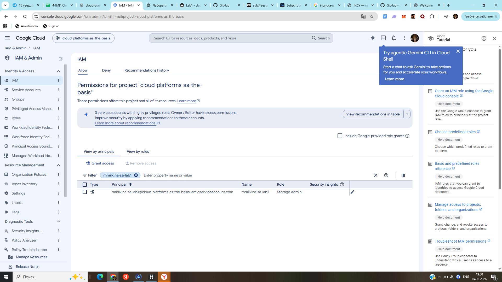
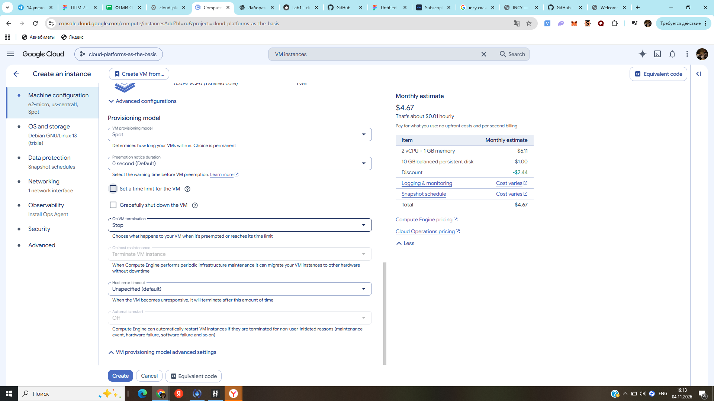
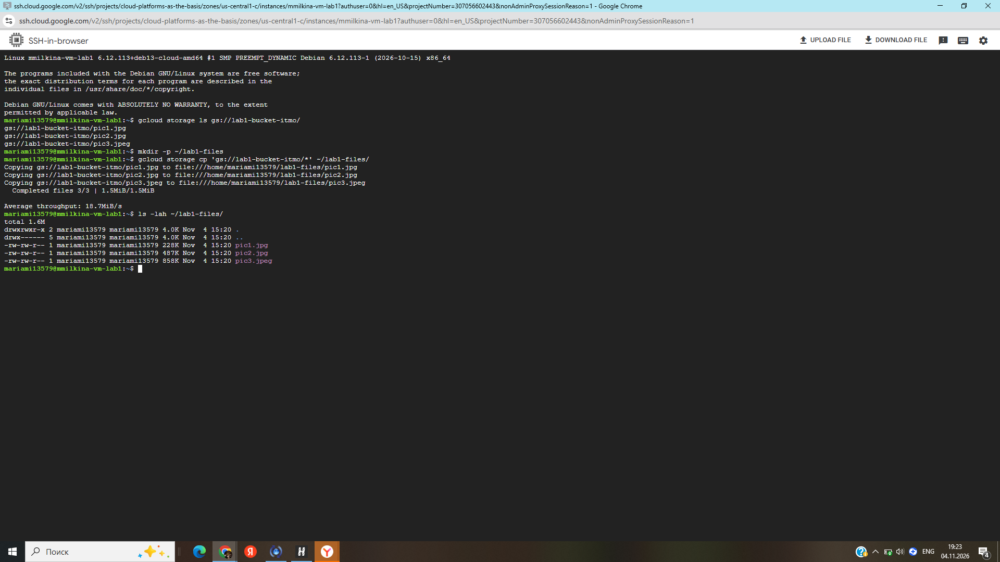
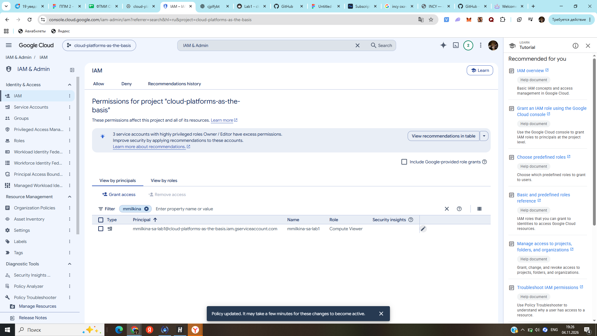
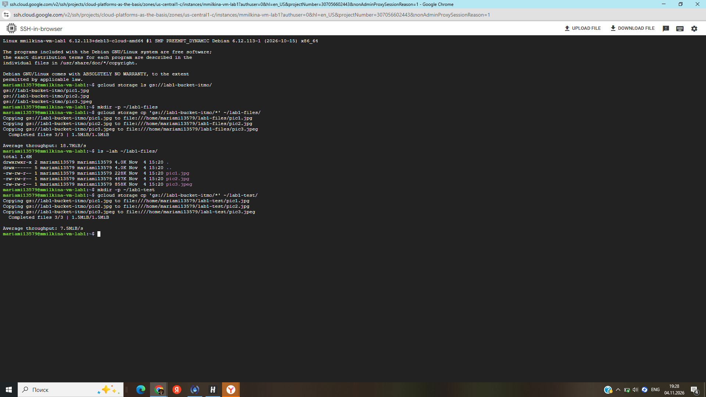
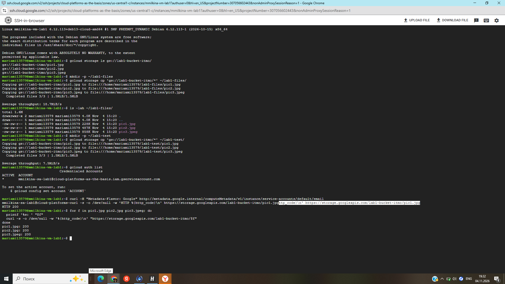
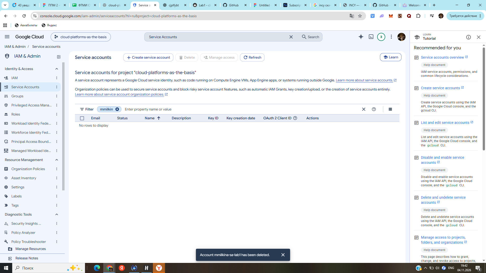

# Лабораторная работа №1 — Обзор Google Cloud и исследование основных сервисов

University: [ITMO University](https://itmo.ru/ru/)  
Faculty: ФТМИ (ИТМО)  
Course: Cloud platforms as the basis of technology entrepreneurship  
Year: 2026/2027  
Group: U4225  
Author: Milkina Maria Igorevna  
Lab: Lab1  
Date of create: 04.11.2026  
Date of finished: **[заполнить после защиты перед преподавателем]**

## 1. Цель работы

Ознакомиться с сервисами Google Cloud, создать сервисный аккаунт с ролью IAM, развернуть виртуальную машину Compute Engine и получить файлы из Cloud Storage; исследовать влияние изменения IAM-роли на доступ к объектам и удалить созданные ресурсы.

## 2. Использованные сервисы

- **IAM & Admin** — управление сервисными аккаунтами и ролями доступа.
- **Compute Engine** — запуск виртуальной машины Debian GNU/Linux.
- **Cloud Storage** — доступ к объектам учебного бакета.
- **gcloud CLI** и **SSH-in-browser** — выполнение команд внутри VM.

Учебный проект: `cloud-platforms-as-the-basis`.

## 3. Ход выполнения работы

### 3.1. Создание сервисного аккаунта

В разделе **IAM & Admin → Service Accounts** создан сервисный аккаунт `mmilkina-sa-lab1` с адресом:

`mmilkina-sa-lab1@cloud-platforms-as-the-basis.iam.gserviceaccount.com`

На уровне проекта ему назначена роль **Storage Admin**, позволяющая управлять бакетами и объектами в пределах соответствующей области действия прав.



### 3.2. Создание виртуальной машины Compute Engine

Создана виртуальная машина с параметрами:

| Параметр | Значение |
|---|---|
| Name | `mmilkina-vm-lab1` |
| Region | `us-central1` |
| Zone | `us-central1-c` |
| Series / machine type | `E2` / `e2-micro` |
| Provisioning model | `Spot` |
| Operating system | Debian GNU/Linux 13 |
| Boot disk | Balanced persistent disk, 10 GB |
| Service account | `mmilkina-sa-lab1` |
| Access scopes | Allow full access to all Cloud APIs |

Плановое резервное копирование отключено. Виртуальная машина запущена, подключение выполнено посредством SSH-in-browser.



### 3.3. Копирование файлов из Cloud Storage

В Linux-терминале выполнены команды:

```bash
gcloud storage ls gs://lab1-bucket-itmo/
mkdir -p ~/lab1-files
gcloud storage cp 'gs://lab1-bucket-itmo/*' ~/lab1-files/
ls -lah ~/lab1-files/
```

Обнаружены и успешно скопированы **три файла**: `pic1.jpg`, `pic2.jpg` и `pic3.jpeg`. Сообщение `Copied 3/3` подтвердило окончание копирования; команда `ls -lah` показала файлы в каталоге VM.



### 3.4. Изменение IAM-роли

В разделе **IAM** исходная роль сервисного аккаунта **Storage Admin** заменена на **Compute Viewer** (не добавлена как дополнительная). Роль Compute Viewer разрешает просмотр ресурсов Compute Engine, но сама по себе не предоставляет чтение объектов Cloud Storage.



Затем создан новый пустой каталог и повторена операция копирования:

```bash
mkdir -p ~/lab1-test
gcloud storage cp 'gs://lab1-bucket-itmo/*' ~/lab1-test/
```

**Фактический результат:** операция вновь завершилась успешно (`Copied 3/3`), а не ошибкой отказа в доступе.



### 3.5. Исследование причины сохранения доступа

Проверка `gcloud auth list` и запрос к серверу метаданных VM показали, что VM использует сервисный аккаунт `mmilkina-sa-lab1`, то есть успешное копирование не связано с использованием другого сервисного аккаунта.

```bash
gcloud auth list
curl -H "Metadata-Flavor: Google"   http://metadata.google.internal/computeMetadata/v1/instance/service-accounts/default/email
```

Дополнительно проверена возможность анонимного HTTPS-доступа ко всем трём объектам без токенов авторизации:

```bash
for f in pic1.jpg pic2.jpg pic3.jpeg; do
  printf '%s: ' "$f"
  curl -s -o /dev/null -w '%{http_code}\n'     "https://storage.googleapis.com/lab1-bucket-itmo/$f"
done
```

Получено:

```text
pic1.jpg: 200
pic2.jpg: 200
pic3.jpeg: 200
```

Код **HTTP 200** для каждого прямого запроса подтверждает возможность получения этих объектов без аутентификации. Поэтому отсутствие у аккаунта роли Storage Admin не препятствовало скачиванию **публично доступных объектов**. При этом из опыта не следует, что у аккаунта с ролью Compute Viewer появился доступ к любым непубличным объектам Cloud Storage.



### 3.6. Удаление созданных ресурсов

После завершения эксперимента удалена виртуальная машина `mmilkina-vm-lab1` вместе с её загрузочным диском; также удалён сервисный аккаунт `mmilkina-sa-lab1`. Учебный бакет `lab1-bucket-itmo` и чужие ресурсы не изменялись.



## 4. Результаты

- Создан сервисный аккаунт и настроена роль Storage Admin.
- Создана Spot VM `e2-micro` с выбранным сервисным аккаунтом.
- Три объекта Cloud Storage успешно скопированы и проверены командой `ls -lah`.
- Роль изменена на Compute Viewer; повторная операция копирования также прошла успешно.
- Экспериментально подтверждён анонимный доступ к трём объектам (HTTP 200), объясняющий наблюдение.
- Созданные в работе VM и сервисный аккаунт удалены.

## 5. Вывод

В ходе лабораторной работы исследованы базовые возможности IAM, Compute Engine и Cloud Storage. Практически проверена работа виртуальной машины с сервисным аккаунтом и доступ к файлам облачного хранилища.

Важное наблюдение: изменение IAM-роли сервисного аккаунта само по себе не гарантирует запрет на скачивание объектов. Необходимо учитывать политику доступа к самим объектам. В данной работе три файла учебного бакета оказались доступны анонимно, поэтому повторное копирование после смены роли завершилось успешно. Такой результат демонстрирует различие между разрешениями идентичности и публичной доступностью данных.

