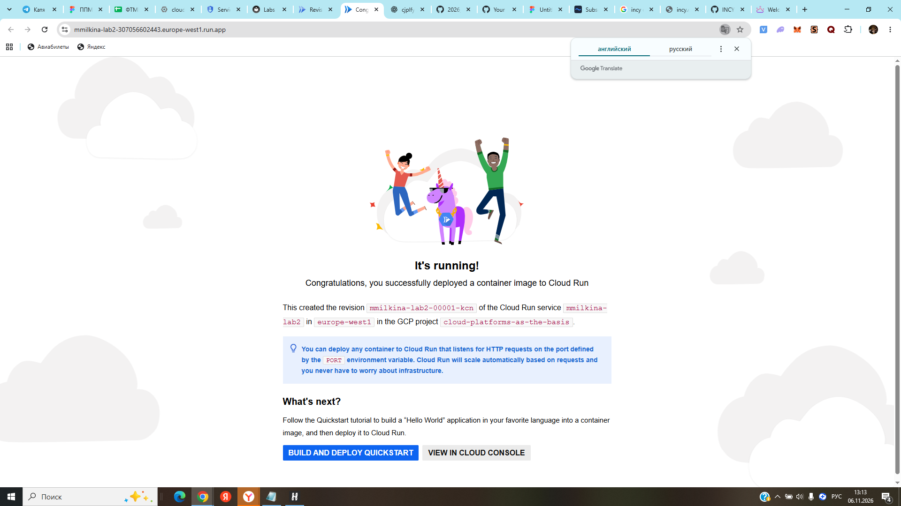
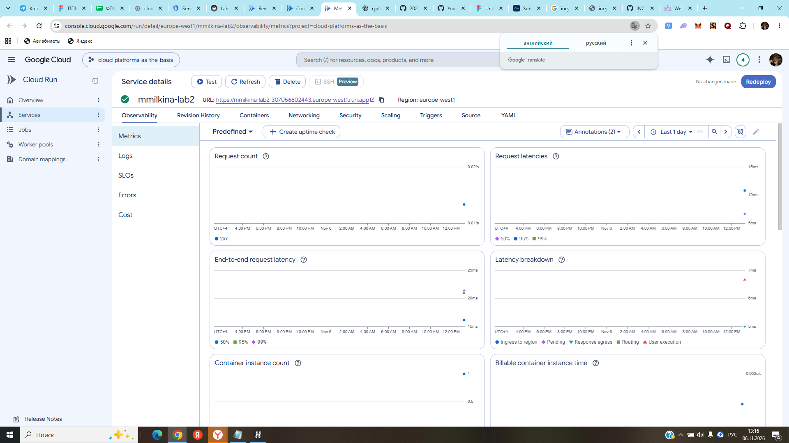
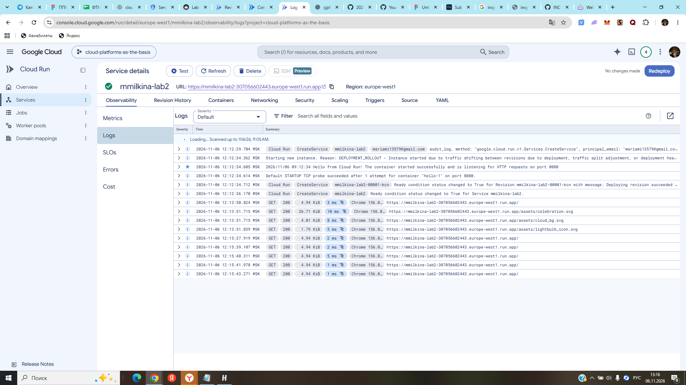
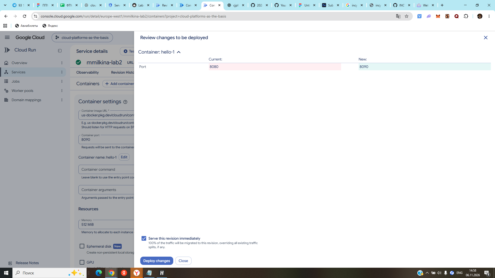
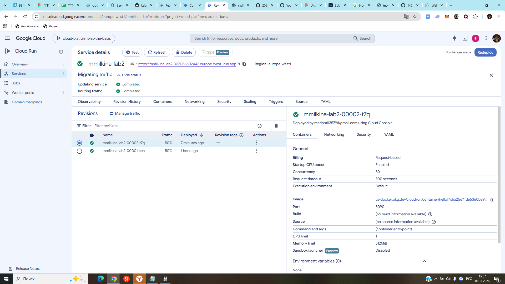
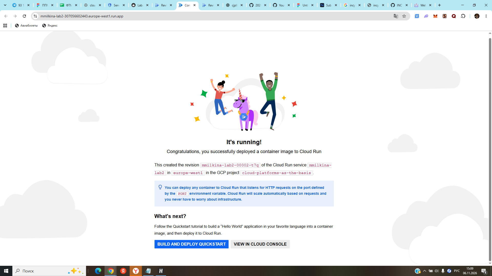
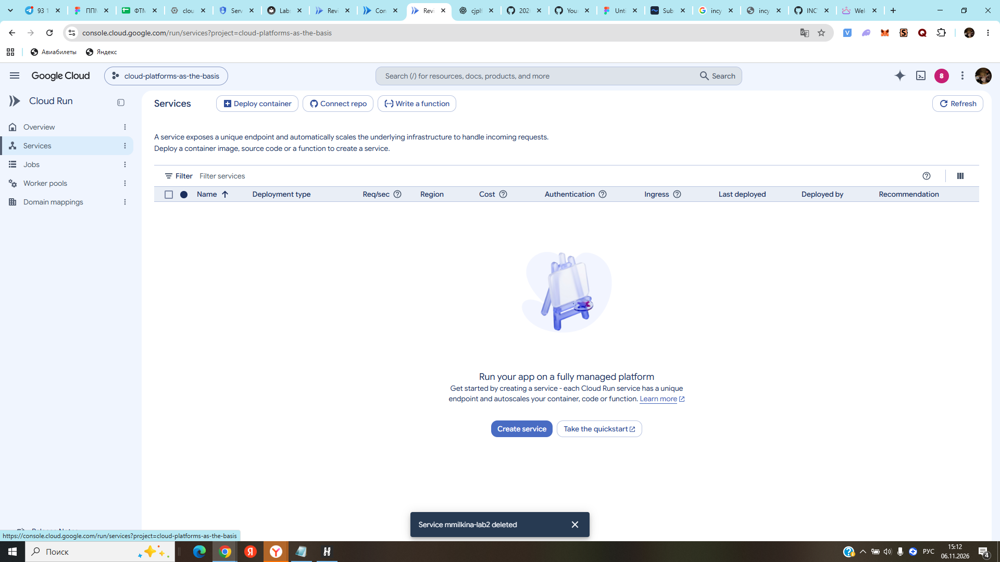

# Лабораторная работа №2. Исследование Cloud Run

University: [ITMO University](https://itmo.ru/ru/)\
Faculty: ФТМИ (ИТМО)\
Course: Cloud platforms as the basis of technology entrepreneurship\
Year: 2026/2027\
Group: U4225\
Author: Milkina Maria Igorevna\
Lab: Lab2\
Date of create: 06.11.2026\
Date of finished:

## 1. Цель работы

Ознакомиться с сервисом Google Cloud Run: развернуть тестовое контейнерное приложение, проверить его доступность, изучить логи и метрики, изменить конфигурацию порта, исследовать механизм ревизий и распределения трафика, затем удалить созданные ресурсы.

## 2. Использованные ресурсы

| Параметр | Значение |
| --- | --- |
| Google Cloud project ID | `cloud-platforms-as-the-basis` |
| Cloud Run service | `mmilkina-lab2` |
| Region | `europe-west1` (Бельгия) |
| Образ | `us-docker.pkg.dev/cloudrun/container/hello` |
| Доступ | Публичный (`Allow public access`) |
| Billing | `Request-based` |
| Автомасштабирование | `Auto scaling`, минимальное число экземпляров — `0` |
| Максимальное число экземпляров | Изначально `1`, для разделения трафика увеличено до `2` |
| Ресурсы контейнера | 1 vCPU, 512 MiB RAM |
| URL сервиса во время выполнения | `https://mmilkina-lab2-307056602443.europe-west1.run.app` (после удаления недоступен) |

## 3. Ход работы

### 3.1. Создание сервиса Cloud Run

В Google Cloud Console открыт раздел **Cloud Run → Services → Deploy container**. Выбран вариант развертывания готового контейнерного образа и тестовый образ **Hello**. Указаны имя `mmilkina-lab2` и регион `europe-west1`. Для тестирования настроены публичный доступ, оплата по запросам и масштабирование до нуля при отсутствии нагрузки.

Сервис успешно создан. Первая ревизия `mmilkina-lab2-00001-kcn` использовала порт `8080`, 1 vCPU и 512 MiB памяти.

После перехода по URL открылась стандартная страница **It's running!**, подтверждающая успешную работу первой ревизии.



### 3.2. Анализ метрик и логов

Для создания тестового трафика страница приложения несколько раз обновлялась в браузере.

Во вкладке **Observability → Metrics** проанализированы графики количества запросов (**Request count**), времени обработки запросов (**Request latencies**), полного времени ответа (**End-to-end request latency**) и числа экземпляров контейнера (**Container instance count**). Появились точки измерений, отражающие запросы после тестирования. На графике успешные запросы отображаются в категории `2xx`.



Во вкладке **Observability → Logs** изучены события создания сервиса и запуска контейнера, а также HTTP-запросы. Логи подтвердили, что контейнер запустился и прослушивал порт `8080`. Запросы к главной странице `/` и статическим ресурсам получили статус `200`.



### 3.3. Изменение порта и создание новой ревизии

В разделе **Containers** значение **Container port** изменено с `8080` на `8090`. При просмотре изменений интерфейс Cloud Run показал, что изменен только порт контейнера. Новая ревизия была развернута без немедленной передачи ей пользовательского трафика.



В результате создана ревизия `mmilkina-lab2-00002-t7q`, а первоначальная `mmilkina-lab2-00001-kcn` продолжила обслуживать 100% запросов.

### 3.4. Исследование распределения трафика между ревизиями

Первоначально попытка распределить трафик **50% / 50%** завершилась ошибкой:

```text
Failed to update traffic.
metadata.annotations[run.googleapis.com/maxScale]:
service level max instances must be greater than or equal to the number of targets receiving traffic.
```

Причина: максимальное количество экземпляров на уровне сервиса было установлено равным `1`, а трафик требовалось направлять на две ревизии. В разделе **Scaling** максимальный лимит был повышен до `2`, минимальный сохранен равным `0`. После этого изменение распределения трафика прошло успешно.

Через **Revision History → Manage traffic** установлено распределение:

| Ревизия | Порт | Доля трафика | Результат |
| --- | ---: | ---: | --- |
| `mmilkina-lab2-00001-kcn` | 8080 | 50% | Доступна, успешно отвечает |
| `mmilkina-lab2-00002-t7q` | 8090 | 50% | Доступна, успешно отвечает |



После нескольких обновлений общей ссылки на сервис наблюдалась работа **обеих** ревизий. В одном из ответов страницы Hello была указана первая ревизия `00001-kcn`, в другом — вторая `00002-t7q`. Обе выводили **It's running!**. При этом внешний URL сервиса не менялся.



**Сравнение:** изменение порта привело к созданию отдельной ревизии, но не изменило содержимое страницы Hello. Процентное распределение трафика позволяет одновременно обслуживать запросы разными версиями контейнера и постепенно выпускать изменения. Доли `50% / 50%` — целевое распределение в конфигурации, а не обязательное строгое чередование ответов на отдельные запросы.

### 3.5. Удаление созданных ресурсов

После завершения тестирования удален сервис `mmilkina-lab2` через **Cloud Run → Delete**. Google Cloud отобразил сообщение `Service mmilkina-lab2 deleted`, после чего список Cloud Run Services в проекте оказался пустым. Ревизии сервиса удалены вместе с ним.



## 4. Результаты

В ходе выполнения лабораторной работы:

1. Создан и проверен тестовый сервис Cloud Run на основе образа Hello.
2. Изучены метрики нагрузки и логи выполнения приложения.
3. Изменен порт контейнера с `8080` на `8090`, создана вторая ревизия.
4. Выявлено и устранено ограничение конфигурации масштабирования при распределении трафика на две ревизии.
5. Успешно настроен трафик `50% / 50%`, обе ревизии проверены через браузер.
6. Созданный сервис удален после завершения эксперимента.

## 5. Вывод

Cloud Run позволяет развертывать контейнерные приложения без ручного администрирования виртуальных машин, автоматически масштабировать их в зависимости от нагрузки и анализировать работу по логам и метрикам. Каждое изменение конфигурации формирует новую ревизию; между ревизиями можно распределять пользовательский трафик. В ходе опыта установлено, что настройки масштабирования на уровне сервиса должны учитывать число ревизий, одновременно принимающих трафик. Удаление тестового сервиса завершило работу с облачными ресурсами.
