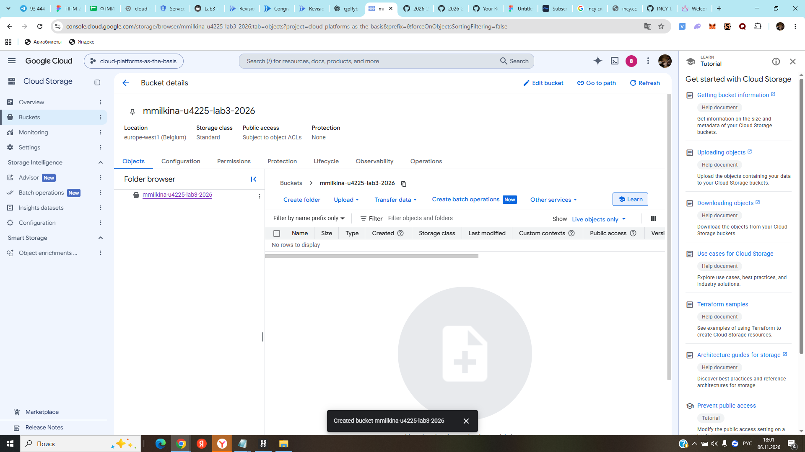
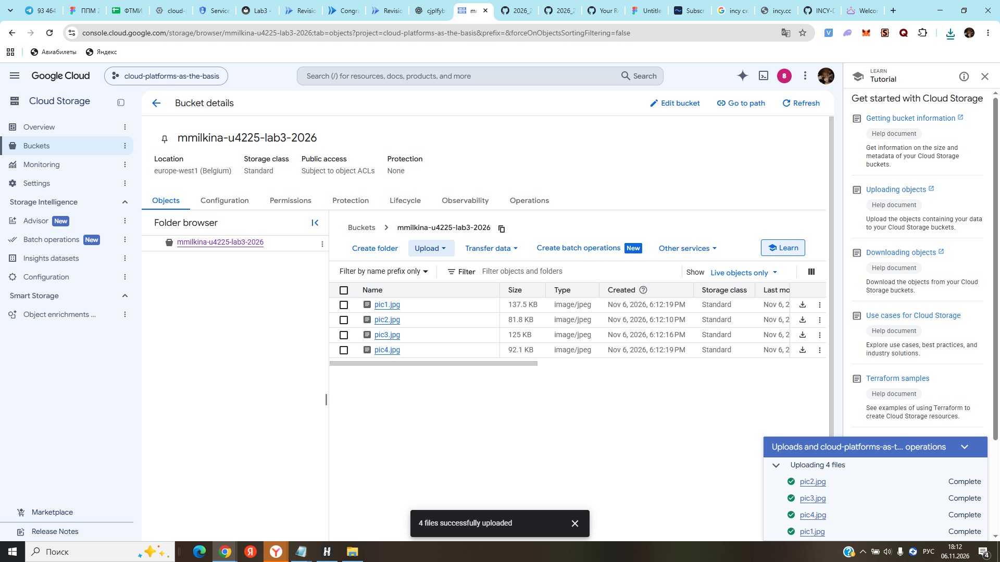
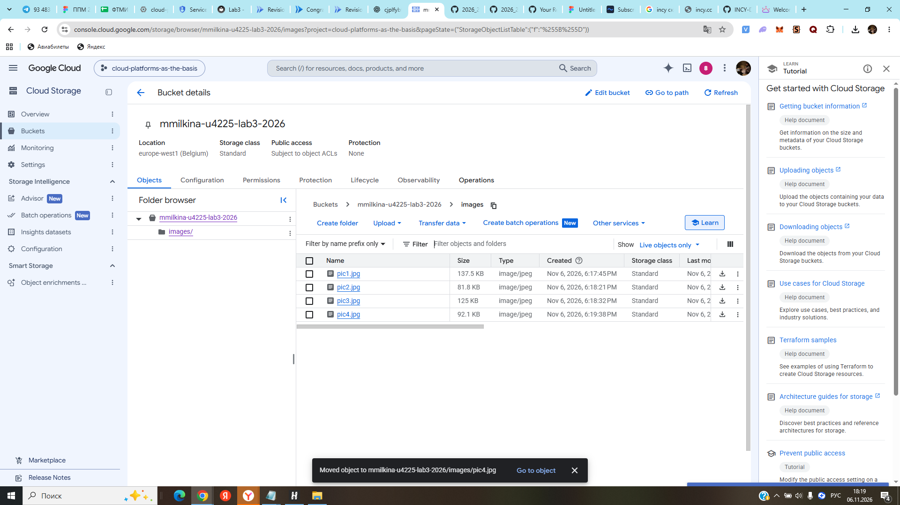
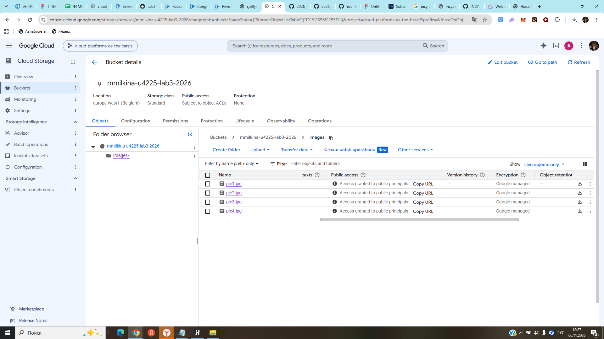
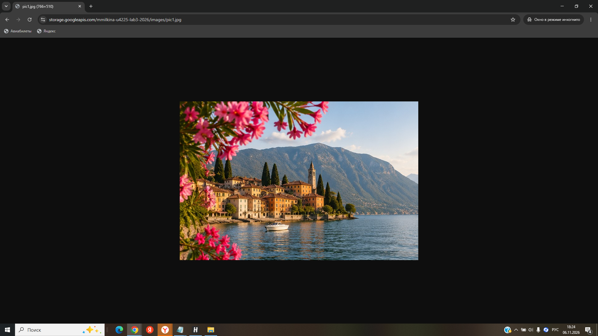
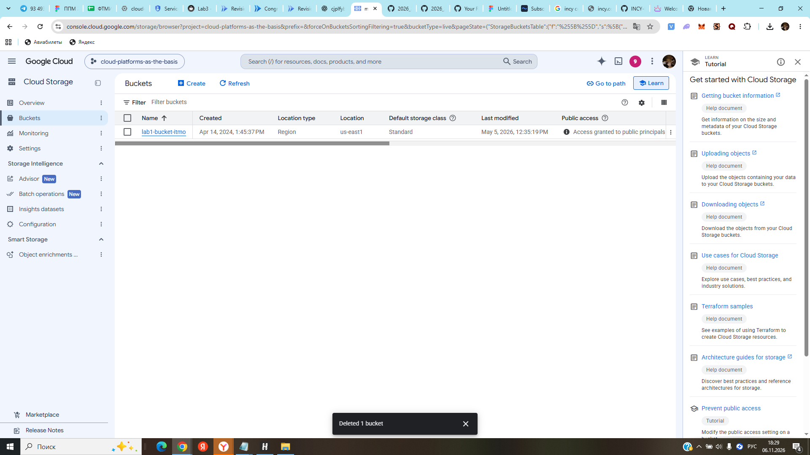

# Лабораторная работа №3. Исследование Cloud Storage

University: [ITMO University](https://itmo.ru/ru/)\
Faculty: ФТМИ (ИТМО)\
Course: Cloud platforms as the basis of technology entrepreneurship\
Year: 2026/2027\
Group: U4225\
Author: Milkina Maria Igorevna\
Lab: Lab3\
Date of create: 06.11.2026\
Date of finished:

## 1. Цель работы

Ознакомиться с основными понятиями и принципами облачного хранения данных, изучить различия между блочным, файловым и объектным хранилищами и на практике исследовать сервис **Google Cloud Storage**: создать бакет, загрузить изображения, организовать их по папкам, настроить публичный доступ, получить публичные ссылки и удалить созданные ресурсы.

## 2. Краткие теоретические сведения

- **Блочное хранилище** хранит данные в виде блоков; часто применяется для дисков виртуальных машин и баз данных.
- **Файловое хранилище** предоставляет файлы и каталоги с общей файловой системой; используется для совместной работы приложений с файлами.
- **Объектное хранилище** хранит объекты (данные и метаданные) в бакетах. Доступ обычно осуществляется по API или URL. Google Cloud Storage относится к объектным хранилищам.

## 3. Используемые ресурсы

| Параметр | Значение |
| --- | --- |
| Облачная платформа | Google Cloud Platform |
| Project ID | `cloud-platforms-as-the-basis` |
| Сервис | Cloud Storage |
| Название бакета | `mmilkina-u4225-lab3-2026` |
| Расположение | `europe-west1` (Belgium) |
| Класс хранения | Standard |
| Управление доступом | Fine-grained (ACL отдельных объектов) |
| Public access prevention | Off |
| Soft delete | Disabled |
| Количество объектов | 4 JPG-изображения |
| Папка в бакете | `images/` |

## 4. Ход работы

### 4.1. Создание бакета

В уже существующем учебном проекте открыт раздел **Cloud Storage → Buckets**. Создан новый бакет `mmilkina-u4225-lab3-2026` в регионе `europe-west1` с классом хранения **Standard**. Для управления доступом к отдельным изображениям выбран режим **Fine-grained**, а ограничение **Prevent public access** отключено. Для временного тестового бакета отключено восстановление удалённых объектов (Soft delete). Шифрование оставлено под управлением Google.



*Рисунок 1 — Созданный бакет и его основные параметры.*

### 4.2. Загрузка четырёх изображений

Через **Upload → Upload files** в корневой каталог бакета загружены четыре тестовых JPG-файла:

| Файл | Размер |
| --- | ---: |
| `pic1.jpg` | 137,5 КБ |
| `pic2.jpg` | 81,8 КБ |
| `pic3.jpg` | 125 КБ |
| `pic4.jpg` | 92,1 КБ |

Панель операций показала успешное завершение всех четырёх загрузок.



*Рисунок 2 — Четыре загруженных изображения и подтверждение успешной загрузки.*

### 4.3. Создание папки и перемещение файлов

В бакете создана папка `images/`. Файлы поочерёдно перемещены в неё с помощью команды **Move** с выбором папки назначения. Итоговая структура объектов:

```text
mmilkina-u4225-lab3-2026/
└── images/
    ├── pic1.jpg
    ├── pic2.jpg
    ├── pic3.jpg
    └── pic4.jpg
```



*Рисунок 3 — Все четыре файла внутри папки `images/`.*

### 4.4. Настройка публичного доступа

Для каждого изображения в разделе **Object details → Edit access** добавлено правило **Public / Reader**, предоставляющее чтение объекта без авторизации. Доступ к файлам настроен индивидуально, а не на весь бакет.

После сохранения правил в таблице объектов для всех четырёх файлов появилось состояние **Access granted to public principals**.



*Рисунок 4 — Публичный доступ предоставлен ко всем четырём изображениям.*

### 4.5. Проверка публичной ссылки

Для `pic1.jpg` скопирован **Public URL** и открыт в отдельном окне браузера в режиме инкогнито. Изображение отобразилось без авторизации Google, что подтверждает доступность объекта по публичной ссылке.

Адрес во время выполнения работы:

```text
https://storage.googleapis.com/mmilkina-u4225-lab3-2026/images/pic1.jpg
```

Пути других объектов имели тот же формат с именами `pic2.jpg`, `pic3.jpg`, `pic4.jpg`. Их публичные ACL подтверждены интерфейсом Cloud Storage (рисунок 4). После удаления бакета данные URL больше не работают.



*Рисунок 5 — `pic1.jpg` успешно открыт по публичной ссылке в режиме инкогнито.*

### 4.6. Удаление созданных ресурсов

После завершения эксперимента через список **Buckets** удалён бакет `mmilkina-u4225-lab3-2026` вместе с размещёнными в нём тестовыми объектами. Интерфейс подтвердил операцию сообщением **Deleted 1 bucket**. Общий учебный бакет `lab1-bucket-itmo` не изменялся.



*Рисунок 6 — Подтверждение удаления учебного бакета.*

## 5. Результаты работы

В ходе лабораторной работы успешно создан бакет Cloud Storage, загружены четыре изображения, организовано их хранение внутри папки `images/`. Для каждого файла настроено индивидуальное правило публичного чтения. На примере `pic1.jpg` проверена возможность открыть объект по HTTP-ссылке в режиме инкогнито. После проверки созданные ресурсы удалены.

## 6. Вывод

Google Cloud Storage позволяет хранить и организовывать данные как объекты в бакетах, независимо от локального устройства. В работе изучены выбор региона и класса хранения, загрузка и перемещение объектов, настройка списков контроля доступа (ACL) и публикация файлов по URL. Практический эксперимент продемонстрировал возможность предоставить публичный доступ к отдельному объекту, не публикуя целиком все данные бакета. По окончании работы тестовый бакет удалён.
