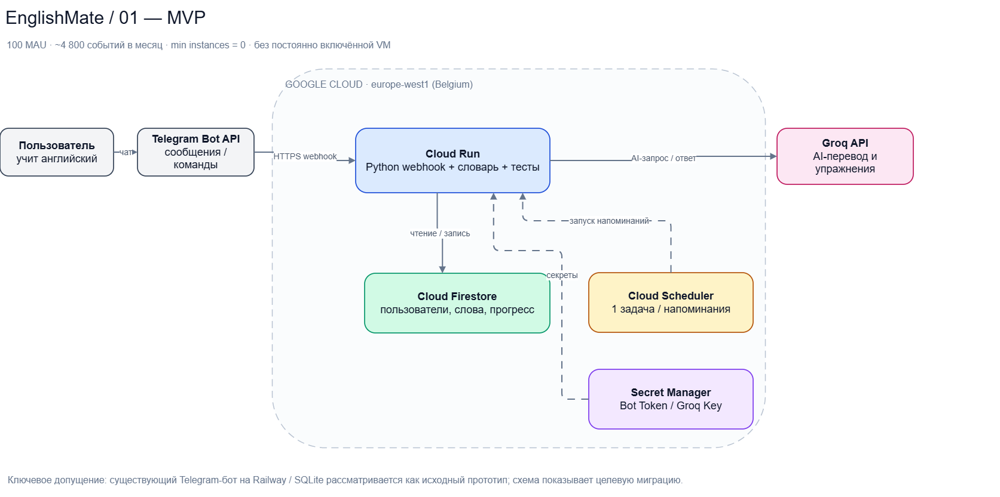
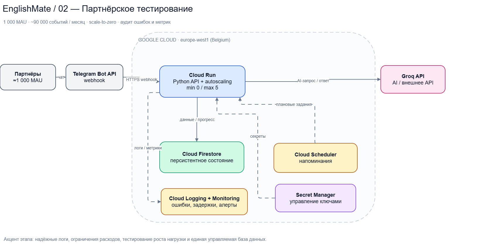
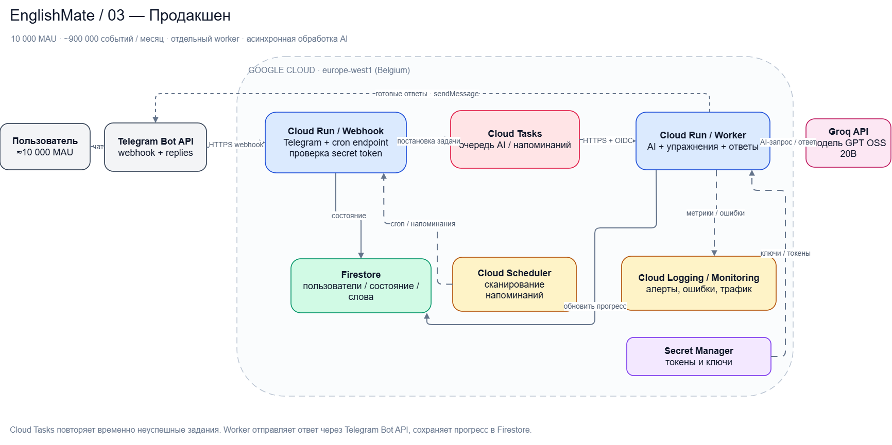

# Лабораторная работа №4 — Разработка инфраструктуры MVP AI-приложения

University: [ITMO University](https://itmo.ru/ru/)\
Faculty: ФТМИ (факультет технологического менеджмента и инноваций)\
Course: Cloud Platforms as the Basis of Technology Entrepreneurship\
Year: 2026/2027\
Group: U4225\
Author: Milkina Maria Igorevna\
Lab: Lab4\
Date of create: 06.11.2026\
Date of finished:

## 1. Цель работы

Спроектировать облачную инфраструктуру минимально жизнеспособного AI-приложения, разработать схему её компонентов в draw.io, обосновать выбор сервисов и рассчитать ориентировочные ежемесячные затраты для трёх стадий развития: MVP, партнёрского тестирования и промышленной эксплуатации. В соответствии с условием лабораторной работа носит **проектный характер**: создавать платные облачные ресурсы не требуется.

## 2. Исходные данные приложения

**EnglishMate** — Telegram-бот для самостоятельного изучения английского языка. В существующем учебном прототипе реализованы проверка уровня английского, персональный словарь, переводчик на основе LLM, тренировочные задания, история прогресса и напоминания. Прототип использует Python, SQLite, Groq API и деплой на Railway. В работе ниже представлена **целевая архитектура при гипотетическом переносе на Google Cloud**, а не утверждение о фактически выполненной миграции.

### 2.1. Функциональные требования

- Обрабатывать команды и сообщения из Telegram с помощью Telegram Bot API.
- Хранить данные пользователя, новые слова и результаты упражнений между перезапусками приложения.
- Обращаться к внешней языковой модели для перевода, объяснения выражений и формирования упражнений.
- Учитывать часовой пояс пользователя и отправлять напоминания об изучении слов.
- Масштабироваться с ростом аудитории и сохранять наблюдаемость системы.

### 2.2. Нефункциональные требования

| Характеристика | MVP | Партнёрский тест | Продакшен |
|---|---|---|---|
| Пользователи за месяц (MAU, допущение) | 100 | 1 000 | 10 000 |
| Доля активных за день (DAU / MAU) | 20% | 25% | 25% |
| Действий на активного пользователя в день | 8 | 12 | 12 |
| Обработка запросов | В одном приложении | В одном приложении с autoscaling | Раздельные webhook и worker |
| Хранение состояния | Firestore | Firestore | Firestore |
| Очередь AI-задач | Не требуется | Не требуется | Cloud Tasks |
| Мониторинг | Базовые логи | Логи, метрики, алерты | Метрики, алерты, retry, контроль ошибок |
| Целевой уровень доступности (проектное требование, не гарантия SLA) | Best effort | 99,5% | 99,9% |

## 3. Архитектурная схема

Полная **редактируемая схема draw.io на трёх страницах** размещена в файле [`englishmate_architecture.drawio`](englishmate_architecture.drawio). Для просмотра необходимо открыть [app.diagrams.net](https://app.diagrams.net/), выбрать **File → Open From → Device** и указать этот файл.

Ниже приведены **все три стадии** в виде схем, экспортированных из draw.io. Исходный `.drawio` содержит редактируемые страницы для каждого сценария.

**Стадия 1 — MVP (100 MAU)**

**Стадия 2 — партнёрское тестирование (1 000 MAU)**

**Стадия 3 — продакшен (10 000 MAU)**

### 3.1. Состав компонентов

| Компонент | Назначение | Причина выбора |
|---|---|---|
| Telegram Bot API | Клиентский интерфейс, приём сообщений | Интерфейс бота уже реализован, не нужен отдельный сайт |
| Cloud Run — Webhook | Приём событий, валидация, быстрое подтверждение webhook | Контейнеры, масштабирование, отсутствие постоянно включённой VM |
| Cloud Run — Worker | Обработка задач, вызов LLM, отправка ответов | Независимое масштабирование долгих запросов |
| Cloud Firestore Standard | Пользователи, словарь, прогресс, настройки времени | Состояние сохраняется при scale-to-zero; документы удобно хранить по user_id |
| Groq API | Внешний AI-инференс | Уже используется в учебном прототипе; не нужен собственный GPU |
| Cloud Scheduler | Периодический поиск напоминаний | Serverless-расписание, не зависит от жизненного цикла приложения |
| Cloud Tasks | Надёжная очередь фоновых запросов в продакшене | Повторные попытки и развязка приёма сообщений от долгой обработки |
| Secret Manager | Хранение токенов Telegram и Groq | Ключи не находятся в коде или репозитории |
| Cloud Logging / Monitoring | Логи, задержки, ошибки, наблюдение за нагрузкой | Контроль качества и диагностика |
| Artifact Registry | Хранение контейнерных образов | Нативный реестр для деплоя Cloud Run |

### 3.2. Стадия 1 — MVP

Используется один контейнер Python в **Cloud Run с request-based billing**, минимум экземпляров — 0, разрешено автоматическое масштабирование. Telegram обращается к сервису через HTTPS webhook. Бот запрашивает AI-ответ в Groq API и хранит данные пользователя в Firestore. Один Cloud Scheduler job вызывается каждый час для поиска уведомлений, которые необходимо отправить в соответствующих часовых поясах. Секреты находятся в Secret Manager.

**Обоснование:** не требуются Compute Engine, GKE, кластер Kubernetes, собственный GPU и отдельный балансировщик. При небольшой неравномерной нагрузке такой набор проще в сопровождении и дешевле постоянно работающей VM.

### 3.3. Стадия 2 — тестирование партнёрами

Сохраняем управляемые сервисы, но увеличиваем допустимый масштаб Cloud Run (например, max instances до 5), включаем контролируемый уровень логирования и настраиваем алерты по ошибкам и задержкам. Проводим нагрузочное тестирование и проверяем, что пользовательские данные продолжают храниться после перезапуска контейнеров.

**Обоснование:** преждевременно вводить микросервисы и очереди, когда гипотеза продукта ещё проверяется. Вместе с тем необходимо фиксировать производительность и наблюдать реальное потребление токенов внешней модели.

### 3.4. Стадия 3 — промышленная эксплуатация

Разделяем Cloud Run на **Webhook Service** и **Worker Service**. Webhook быстро проверяет входящее событие и помещает длительные операции в Cloud Tasks. Worker выполняет AI-запрос, сохраняет результат в Firestore и отправляет сообщение пользователю через Telegram Bot API. Плановые уведомления инициирует Cloud Scheduler; дальнейшая доставка также может использовать Cloud Tasks. При сбоях применяются retry, ограничение числа попыток и мониторинг очереди.

**Обоснование:** ответ Telegram на webhook не должен ожидать долгого выполнения AI-инференса. Очередь позволяет управлять всплесками нагрузки и ограничениями внешнего API. Cloud Run отдельно масштабирует приём запросов и обработчики.

### 3.5. Потоки данных и защита

1. Пользователь отправляет сообщение Telegram-боту.
2. Telegram Bot API отправляет HTTPS webhook в Cloud Run.
3. Backend проверяет подлинность webhook (секретный заголовок), определяет команду и сохраняет изменения в Firestore.
4. Если нужен AI, backend или worker обращается к Groq; полученный ответ проверяется и отправляется пользователю.
5. Cloud Scheduler с учётом часовых поясов инициирует напоминания; повторная отправка не должна создавать дубликаты.
6. Токены и другие секреты берутся из Secret Manager. Доступ сервиса к Firestore ограничивается IAM service account с минимальными полномочиями.

Данные пользователей не размещаются в локальном файле SQLite на контейнере Cloud Run: файловая система контейнера эфемерна, поэтому требуется управляемая внешняя БД. Для продакшена предусматриваются лимиты Groq, таймауты, обработка 429/5xx, защита от дублей и бюджетные оповещения.

## 4. Экономическая модель

**Метод:** bottom-up по предполагаемому числу запросов, токенов, вычислительным секундам и операциям с БД. Это **проектная оценка**, а не фактические счета Google Cloud или Groq. Все числовые вводные и формулы можно изменить в [`englishmate_cost_model.xlsx`](englishmate_cost_model.xlsx), листы `Assumptions`, `Unit prices` и `Forecast`.

### 4.1. Исходные допущения

| Параметр | MVP | Партнёры | Продакшен |
|---|---:|---:|---:|
| MAU | 100 | 1 000 | 10 000 |
| DAU / MAU | 20% | 25% | 25% |
| Действий на DAU за день | 8 | 12 | 12 |
| Действий за 30 дней | 4 800 | 90 000 | 900 000 |
| Доля действий с AI | 40% | 40% | 40% |
| AI-вызовов за месяц | 1 920 | 36 000 | 360 000 |
| Напоминаний за месяц | 600 | 7 500 | 75 000 |
| Примерные токены на AI-вызов | 600 input + 250 output | то же | то же |
| Объём данных в Firestore | 0,05 GiB | 0,3 GiB | 2 GiB |

**Важно:** исходные данные выше выбраны для сравнения вариантов архитектуры. При реальном запуске необходимо заменить их результатами нагрузочного тестирования, аналитикой Telegram-бота и фактическими токенами API.

### 4.2. Используемые тарифы

По состоянию на **06.11.2026** в модели применены следующие публичные цены и квоты:

- **Groq `openai/gpt-oss-20b`:** 0,075 USD за 1 млн входных и 0,30 USD за 1 млн выходных токенов. Модель выбрана в качестве *расчётного* тарифного аналога; если в рабочем боте используется другая модель Groq, тарифы нужно обновить. [Официальные модели Groq](https://console.groq.com/docs/models).
- **Cloud Run (request-based, Tier 1):** 180 000 vCPU-сек, 360 000 GiB-сек и 2 млн запросов в месяц без оплаты при наличии доступной free quota; сверх неё — 0,000024 USD/vCPU-сек и 0,0000025 USD/GiB-сек, 0,40 USD за 1 млн запросов. [Тариф Cloud Run](https://cloud.google.com/run/pricing).
- **Firestore Standard:** 50 000 чтений и 20 000 записей в день, 1 GiB хранения бесплатно для первой подходящей БД в проекте; сверх лимита в расчёте 0,03 USD за 100 000 чтений, 0,09 USD за 100 000 записей, 0,15 USD/GiB-месяц. [Тариф Firestore](https://cloud.google.com/firestore/pricing).
- **Cloud Scheduler:** первые три задачи бесплатны **на billing account**, дальше 0,10 USD за задачу в месяц. Для EnglishMate предполагается одна задача. [Тариф Scheduler](https://cloud.google.com/scheduler/pricing).
- **Cloud Tasks:** первые 1 млн billable operations в месяц без оплаты. [Тариф Cloud Tasks](https://cloud.google.com/tasks/pricing).
- **Secret Manager:** первые шесть активных версий и 10 000 обращений к секретам в месяц бесплатны на billing account. [Тариф Secret Manager](https://cloud.google.com/secret-manager/pricing).
- **Cloud Logging:** 50 GiB логов на проект в месяц бесплатно. [Тариф Cloud Logging](https://cloud.google.com/products/observability/pricing).

### 4.3. Основные формулы

Количество операций в месяц:

`Requests = MAU × (DAU/MAU) × actions_per_DAU × 30`

Количество обращений к языковой модели:

`AI_calls = Requests × AI_share`

Стоимость AI:

`Groq_cost = AI_calls × (600 × 0.075 + 250 × 0.30) / 1 000 000`

Стоимость Cloud Run:

`Run_cost ≈ max(0, vCPU_seconds − 180000) × 0.000024 + max(0, GiB_seconds − 360000) × 0.0000025`

Для MVP и партнёрского теста принято 1,2 секунды оплачиваемого времени на событие; для промышленного этапа — 0,2 секунды на приём webhook + 2,5 секунды на один вызов AI в worker. Также учитываются плановые напоминания и вызовы Scheduler. Точные затраты Cloud Run зависят от параллелизма, времени запуска экземпляров, региона и характера нагрузки; модель намеренно упрощена.

### 4.4. Результаты расчёта (USD / месяц)

| Статья расходов | MVP | Партнёры | Продакшен |
|---|---:|---:|---:|
| Groq API | 0,23 | 4,32 | 43,20 |
| Cloud Run, CPU + RAM | 0,00 | 0,00 | 22,62 |
| Firestore, операции + хранение | 0,00 | 0,00 | 0,26 |
| Artifact Registry | 0,00 | 0,00 | 0,05 |
| Cloud Tasks, Scheduler, Secret Manager, Logging (в принятых квотах) | 0,00 | 0,00 | 0,00 |
| **Оценка без резерва** | **0,23** | **4,32** | **66,13** |
| Резерв 20% на неточность исходных данных | 0,05 | 0,86 | 13,23 |
| **Оценка с резервом** | **0,28** | **5,18** | **79,36** |
| **Рекомендуемый учебный бюджетный лимит** | **5** | **15** | **100** |

Значения представляют **переменные эксплуатационные расходы в рамках модели**. Сумма может увеличиться, если бесплатные квоты уже заняты другими проектами, возрастут токены LLM, количество ретраев или потребуется оплачиваемый межрегиональный / интернет-трафик. В таблицу **не включены** трудозатраты, налоги, поддержка, полноценное резервное копирование, дополнительное хранение логов и отдельные платные сервисы отказоустойчивости. Поэтому столбец «рекомендуемый лимит» следует понимать как условный бюджет контроля, а не гарантию отсутствия перерасхода.

### 4.5. Что изменится при росте нагрузки

На стадии MVP и тестирования партнёрами основная управляемая статья расходов — **количество AI-вызовов и средняя длина ответа**. При увеличении аудитории становятся заметнее CPU-секунды Cloud Run. Введение Cloud Tasks на продакшен-этапе позволяет принимать запросы отдельно от длительной AI-обработки, хотя усложняет архитектуру. Для контроля затрат необходимы лимиты на AI-запросы, кэширование повторяющихся объяснений, ограничения длины ответов, бюджеты и алерты.

## 5. Сравнение возможных решений

| Вариант | Преимущества | Недостатки / решение |
|---|---|---|
| Compute Engine VM + SQLite | Просто для локального прототипа | Постоянная VM, ручное администрирование, сложнее масштабирование; не выбрано |
| Cloud Run + Firestore + Groq | Serverless, быстрый старт, единая БД | Зависимость от внешнего API, риск cold start; выбран для MVP и тестов |
| GKE + Cloud SQL + собственная LLM на GPU | Полный контроль и гибкость | Дороже и сложнее для сравнительно малого Telegram-бота; не выбрано |
| Cloud Run Webhook + Worker + Cloud Tasks + Firestore | Изоляция долгих задач, управляемые повторные попытки | Больше компонентов и логики обработки ошибок; выбран для продакшена |

## 6. Риски и ограничения

1. **Внешний AI API:** квоты, задержки, изменение тарифов и доступности. Меры: rate limits, кэш, graceful degradation, возможность смены модели.
2. **Пропуск напоминаний:** фоновые потоки в масштабируемом Cloud Run нельзя держать как единственный планировщик. Меры: Cloud Scheduler, хранение состояния выполнения и идемпотентность.
3. **Безопасность:** утечка Bot Token / API Key. Меры: Secret Manager, IAM, проверка Telegram webhook, отсутствие ключей в GitHub.
4. **Пиковая нагрузка:** ограничение Cloud Run max instances и пропускной способности Groq. Меры: измерение p95 latency, очереди, ограничение concurrency.
5. **Доступность:** целевые 99,9% не обеспечиваются одной настройкой, зависят от Telegram, Groq, Google Cloud и архитектуры восстановления. Меры: мониторинг, retry, возможность резервного провайдера для критичных сценариев.
6. **Стоимость:** бесплатные квоты могут использовать другие проекты того же billing account. Меры: бюджеты Google Cloud и лимиты потребления.

## 7. Вывод

Спроектированы три варианта инфраструктуры AI-приложения EnglishMate, отражающие изменение требований при росте пользователей. Для MVP и тестирования обоснован выбор serverless-архитектуры Cloud Run + Firestore + Groq, позволяющей снизить необходимость администрирования. Для продакшен-этапа предусмотрено разделение приёма запросов и фоновой AI-обработки через Cloud Tasks. Выполнена ориентировочная экономическая модель с параметризуемыми исходными данными: **0,23 / 4,32 / 66,13 USD в месяц без резерва** соответственно для трёх сценариев. Построены редактируемая схема draw.io и расчётный файл Excel. Реальное развёртывание ресурсов в рамках лабораторной не проводилось, что соответствует условию преподавателя.

## 8. Артефакты и источники

- [Редактируемая схема draw.io, три страницы](englishmate_architecture.drawio)
- [MVP — PNG](screenshots/01_mvp.png)
- [Партнёрский этап — PNG](screenshots/02_partners.png)
- [Продакшен — PNG](screenshots/03_production.png)
- [Экономическая модель Excel с формулами](englishmate_cost_model.xlsx)
- [Google Cloud Run Pricing](https://cloud.google.com/run/pricing)
- [Google Cloud Firestore Pricing](https://cloud.google.com/firestore/pricing)
- [Cloud Tasks Pricing](https://cloud.google.com/tasks/pricing)
- [Cloud Scheduler Pricing](https://cloud.google.com/scheduler/pricing)
- [Secret Manager Pricing](https://cloud.google.com/secret-manager/pricing)
- [Groq Models & Pricing](https://console.groq.com/docs/models)

*Дата проверки тарифов: 06.11.2026. Цены и квоты могут измениться. Все числовые допущения об активности пользователей и количестве токенов являются сценарными.*
